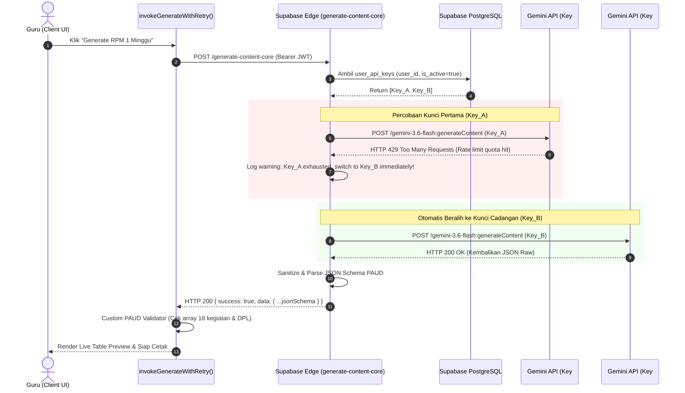

# Arsitektur Sistem & Spesifikasi Teknis
## Kalandra PAUD: Generator Dokumen Perencanaan Pembelajaran Mendalam (RPM) TK

> **Pola Arsitektur:** 3-Layer Decoupled (Client UI + Supabase Edge Functions + PostgreSQL RLS + Gemini AI BYOK)  
> **Kompatibilitas:** Standar Kurikulum PAUD Permendikdasmen No. 10/2025, 12/2025, 1/2026, dan Keputusan BSKAP No. 046/H/KR/2025  

---

## 1. Tinjauan Arsitektur Tingkat Tinggi (High-Level Architecture)

Aplikasi dibangun menggunakan pola arsitektur decoupled tiga lapis yang memisahkan logika antarmuka pengguna, orkestrasi inferensi AI di edge, dan penyimpanan data terisolasi:

```
┌─────────────────────────────────────────────────────────────────────────────────┐
│                          LAPISAN 1: CLIENT FRONTEND                             │
│                  (Vite + React 19 + TypeScript + Tailwind v4)                   │
├─────────────────────────────────────────────────────────────────────────────────┤
│  ┌───────────────────────┐  ┌───────────────────────┐  ┌─────────────────────┐  │
│  │   Role: GURU          │  │ Role: ADMIN (CREATOR) │  │  Shared Components  │  │
│  │  - 4-Step RPM Wizard  │  │  - User Management    │  │  - BYOK Key Manager │  │
│  │  - Live Table Editor  │  │  - Platform Telemetry │  │  - DPL/CP Selector  │  │
│  │  - Document History   │  │  - Master Curriculum  │  │  - Auth Modals      │  │
│  └───────────┬───────────┘  └───────────┬───────────┘  └──────────┬──────────┘  │
│              │                          │                         │             │
│              ▼                          ▼                         ▼             │
│  ┌───────────────────────────────────────────────────────────────────────────┐  │
│  │  Client Resilience Layer: invokeGenerateWithRetry()                       │  │
│  │  - Exponential backoff (800ms -> 1600ms -> 3200ms)                        │  │
│  │  - Custom PAUD JSON Schema Validator                                      │  │
│  └──────────────────────────────────────┬────────────────────────────────────┘  │
│                                         │                                       │
│  ┌──────────────────────────────────────┴────────────────────────────────────┐  │
│  │  Client-Side DOCX Engine (docx library + FileSaver)                       │  │
│  │  - A4 / F4 Page Setup (Margin 3-2.5-2-2.5 cm)                             │  │
│  │  - OOXML Table cantSplit & tblHeader                                      │  │
│  │  - Zero Server Load Document Compilation                                  │  │
│  └───────────────────────────────────────────────────────────────────────────┘  │
└────────────────────────────────────────┬────────────────────────────────────────┘
                                         │ HTTPS / Bearer JWT
                                         ▼
┌─────────────────────────────────────────────────────────────────────────────────┐
│                    LAPISAN 2: SUPABASE EDGE BACKEND                             │
│                           (Deno TypeScript Edge)                                │
├─────────────────────────────────────────────────────────────────────────────────┤
│  Edge Function: `generate-content-core`                                         │
│  ├── 1. Auth Guard & JWT Verifier (`supabase.auth.getUser()`)                   │
│  ├── 2. User Key Pool Aggregator (Fetch active keys for user or custom payload) │
│  ├── 3. Dynamic Prompt Assembler (Inject System Rules, DPL, CP verbatim, DAP)   │
│  ├── 4. Dual-Loop Resilient Engine:                                             │
│  │     ├── Outer Loop: Key Pool Rotation (Catches HTTP 429 Rate Limits)         │
│  │     └── Inner Loop: Model Chain Fallback (3.6 -> 3.5/3.0 -> 2.5 -> 2.5-lite) │
│  └── 5. Markdown JSON Stripper & Structure Parser                               │
└────────────────────────────────────────┬────────────────────────────────────────┘
                                         │
                   ┌─────────────────────┴─────────────────────┐
                   ▼                                           ▼
┌───────────────────────────────────────┐   ┌─────────────────────────────────────┐
│       LAPISAN 3A: DATABASE            │   │      LAPISAN 3B: AI PROVIDER        │
│   (Supabase PostgreSQL 15 + RLS)      │   │     (Google Gemini API v1beta)      │
├───────────────────────────────────────┤   ├─────────────────────────────────────┤
│  • profiles (Roles: 'admin'/'guru')   │   │  • gemini-3.6-flash                 │
│  • schools (Profil Satuan PAUD)       │   │  • gemini-3.5-flash                 │
│  • user_api_keys (BYOK Multi-Key)     │   │  • gemini-3.0-flash                 │
│  • generated_documents (JSON Payload) │   │  • gemini-2.5-flash                 │
│  • curriculum_cp (Master CP 2025)     │   │  • gemini-2.5-flash-lite            │
│  • audit_logs (Laporan Aktivitas)     │   │                                     │
└───────────────────────────────────────┘   └─────────────────────────────────────┘
```

---

## 2. Skema Database & Row Level Security (RLS)

Berikut adalah skema DDL PostgreSQL lengkap yang mendukung peran **admin** dan **guru**, manajemen kunci **BYOK**, penyimpanan draf perencanaan, dan log audit:

```sql
-- ==============================================================================
-- 1. TABEL: schools (Profil Satuan PAUD / TK)
-- ==============================================================================
CREATE TABLE IF NOT EXISTS public.schools (
  id UUID PRIMARY KEY DEFAULT gen_random_uuid(),
  name TEXT NOT NULL,
  npsn TEXT UNIQUE,
  address TEXT DEFAULT '',
  village TEXT DEFAULT '',
  subdistrict TEXT DEFAULT '',
  city_regency TEXT DEFAULT '',
  province TEXT DEFAULT '',
  principal_name TEXT NOT NULL DEFAULT '',
  principal_nip TEXT DEFAULT '',
  logo_url TEXT DEFAULT '',
  created_at TIMESTAMPTZ NOT NULL DEFAULT now(),
  updated_at TIMESTAMPTZ NOT NULL DEFAULT now()
);

-- ==============================================================================
-- 2. TABEL: profiles (Role-Based Access: 'admin' vs 'guru')
-- ==============================================================================
CREATE TABLE IF NOT EXISTS public.profiles (
  id UUID PRIMARY KEY REFERENCES auth.users(id) ON DELETE CASCADE,
  school_id UUID REFERENCES public.schools(id) ON DELETE SET NULL,
  email TEXT NOT NULL,
  full_name TEXT NOT NULL,
  role TEXT NOT NULL DEFAULT 'guru' CHECK (role IN ('admin', 'guru')),
  nip TEXT DEFAULT '',
  assigned_class TEXT DEFAULT 'A (4-5 Tahun)', -- 'A (4-5 Tahun)' atau 'B (5-6 Tahun)'
  phone TEXT DEFAULT '',
  avatar_url TEXT DEFAULT '',
  is_active BOOLEAN NOT NULL DEFAULT true,
  created_at TIMESTAMPTZ NOT NULL DEFAULT now(),
  updated_at TIMESTAMPTZ NOT NULL DEFAULT now()
);

-- ==============================================================================
-- 3. TABEL: user_api_keys (BYOK Multi-Key Pooling)
-- ==============================================================================
CREATE TABLE IF NOT EXISTS public.user_api_keys (
  id UUID PRIMARY KEY DEFAULT gen_random_uuid(),
  user_id UUID NOT NULL REFERENCES auth.users(id) ON DELETE CASCADE,
  provider TEXT NOT NULL DEFAULT 'gemini' CHECK (provider IN ('gemini', 'openai', 'anthropic')),
  api_key TEXT NOT NULL,
  label TEXT DEFAULT '',
  is_active BOOLEAN NOT NULL DEFAULT true,
  last_used_at TIMESTAMPTZ,
  created_at TIMESTAMPTZ NOT NULL DEFAULT now(),
  updated_at TIMESTAMPTZ NOT NULL DEFAULT now()
);

CREATE INDEX IF NOT EXISTS idx_user_api_keys_lookup 
  ON public.user_api_keys(user_id, provider, is_active);

-- ==============================================================================
-- 4. TABEL: generated_documents (Penyimpanan Dokumen RPM PAUD)
-- ==============================================================================
CREATE TABLE IF NOT EXISTS public.generated_documents (
  id UUID PRIMARY KEY DEFAULT gen_random_uuid(),
  user_id UUID NOT NULL REFERENCES auth.users(id) ON DELETE CASCADE,
  school_id UUID REFERENCES public.schools(id) ON DELETE SET NULL,
  title TEXT NOT NULL,
  jenjang_kelas TEXT NOT NULL DEFAULT 'A (4-5 Tahun)',
  semester TEXT NOT NULL DEFAULT '1 (Gasal)',
  minggu_ke TEXT NOT NULL DEFAULT '1',
  bulan TEXT NOT NULL DEFAULT '',
  topik_subtopik TEXT NOT NULL,
  dpl_selected TEXT[] NOT NULL DEFAULT '{}',
  used_model TEXT DEFAULT 'gemini-3.6-flash',
  document_json JSONB NOT NULL,
  is_starred BOOLEAN NOT NULL DEFAULT false,
  created_at TIMESTAMPTZ NOT NULL DEFAULT now(),
  updated_at TIMESTAMPTZ NOT NULL DEFAULT now()
);

CREATE INDEX IF NOT EXISTS idx_generated_docs_user 
  ON public.generated_documents(user_id, created_at DESC);
CREATE INDEX IF NOT EXISTS idx_generated_docs_school 
  ON public.generated_documents(school_id, created_at DESC);

-- ==============================================================================
-- 5. TABEL: audit_logs (Aktivitas Sistem & Admin Monitor)
-- ==============================================================================
CREATE TABLE IF NOT EXISTS public.audit_logs (
  id UUID PRIMARY KEY DEFAULT gen_random_uuid(),
  user_id UUID REFERENCES auth.users(id) ON DELETE SET NULL,
  school_id UUID REFERENCES public.schools(id) ON DELETE SET NULL,
  action TEXT NOT NULL, -- e.g. 'DOCUMENT_GENERATED', 'DOCX_EXPORTED', 'USER_KEY_ADDED'
  details JSONB DEFAULT '{}',
  created_at TIMESTAMPTZ NOT NULL DEFAULT now()
);

-- ==============================================================================
-- ROW LEVEL SECURITY (RLS) POLICIES
-- ==============================================================================
ALTER TABLE public.schools ENABLE ROW LEVEL SECURITY;
ALTER TABLE public.profiles ENABLE ROW LEVEL SECURITY;
ALTER TABLE public.user_api_keys ENABLE ROW LEVEL SECURITY;
ALTER TABLE public.generated_documents ENABLE ROW LEVEL SECURITY;
ALTER TABLE public.audit_logs ENABLE ROW LEVEL SECURITY;

-- Helper Function: Memeriksa apakah pemanggil adalah Admin
CREATE OR REPLACE FUNCTION public.is_admin()
RETURNS BOOLEAN AS $$
BEGIN
  RETURN EXISTS (
    SELECT 1 FROM public.profiles
    WHERE id = auth.uid() AND role = 'admin' AND is_active = true
  );
END;
$$ LANGUAGE plpgsql SECURITY DEFINER;

-- Kebijakan Profiles
CREATE POLICY "Users can view own profile or creator can view all" ON public.profiles
  FOR SELECT USING (
    auth.uid() = id OR 
    public.is_admin()
  );

CREATE POLICY "Users can update own profile" ON public.profiles
  FOR UPDATE USING (auth.uid() = id);

CREATE POLICY "Admin creator can manage all user profiles" ON public.profiles
  FOR ALL USING (public.is_admin());

-- Kebijakan User API Keys (STRICT: Hanya pemilik key yang dapat mengakses)
CREATE POLICY "Users manage own api keys only" ON public.user_api_keys
  FOR ALL
  USING (auth.uid() = user_id)
  WITH CHECK (auth.uid() = user_id);

-- Kebijakan Generated Documents
CREATE POLICY "Guru can read and write own documents" ON public.generated_documents
  FOR ALL
  USING (auth.uid() = user_id)
  WITH CHECK (auth.uid() = user_id);

CREATE POLICY "Admin creator can view documents for support and metrics" ON public.generated_documents
  FOR SELECT
  USING (public.is_admin());

-- Kebijakan Audit Logs
CREATE POLICY "Users can insert audit logs" ON public.audit_logs
  FOR INSERT WITH CHECK (auth.uid() = user_id);

CREATE POLICY "Admin creator can view all platform audit logs" ON public.audit_logs
  FOR SELECT USING (public.is_admin());
```

---

## 3. Diagram Alur & Logika Failover BYOK Multi-Key

Diagram urutan (*Sequence Diagram*) berikut mengilustrasikan penanganan transparan ketika sebuah kunci API mengalami limit kuota (*HTTP 429*):



### Logika Eksekusi Dual-Loop di Edge Function:
```typescript
keyLoop: for (let kIdx = 0; kIdx < userApiKeys.length; kIdx++) {
  const currentKey = userApiKeys[kIdx];
  const keyShort = `...${currentKey.slice(-4)}`;

  for (const model of GEMINI_MODEL_CHAIN) {
    try {
      const res = await fetch(getGeminiEndpoint(model, currentKey), {
        method: "POST",
        headers: { "Content-Type": "application/json" },
        body: JSON.stringify(requestPayload),
      });

      if (res.ok) {
        const jsonRes = await res.json();
        successfulData = jsonRes.candidates?.[0]?.content?.parts?.[0]?.text;
        usedModel = model;
        break keyLoop; // Sukses, langsung keluar dari kedua loop!
      }

      // HTTP 429 Quota Exhausted -> Rotasi ke Kunci berikutnya seketika!
      if (res.status === 429) {
        console.warn(`[BYOK] Quota limit 429 pada key ${keyShort}. Pindah ke key berikutnya.`);
        break; // Lompati model chain lain pada key yang sama, langsung ganti key
      }

      // HTTP 404 Model Not Found atau 503 Overloaded -> Coba model berikutnya dengan key sama
      if (res.status === 404 || res.status === 503) {
        continue;
      }

      // HTTP 401/403 Kunci Tidak Valid -> Lompati key ini
      if (res.status === 401 || res.status === 403) {
        break;
      }
    } catch (networkErr) {
      lastError = `Network error: ${networkErr}`;
    }
  }
}
```

---

## 4. Validasi Klien & Pipeline Ketahanan (`invokeWithRetry`)

Pada sisi klien, pemanggilan dibungkus oleh validator skema spesifik PAUD:
1. **Exponential Backoff**: Jeda bertahap $800ms \times 2^{\text{attempt}-1}$ jika terjadi *network drop* atau *timeout* (HTTP 502/503/504).
2. **PAUD Custom Schema Validator**:
   ```typescript
   export function validatePaudDocSchema(data: any): string | null {
     if (!data || typeof data !== 'object') return 'Respons bukan objek JSON yang valid';
     if (!data.informasi_umum?.topik_subtopik) return 'Field informasi umum topik belum terisi';
     if (!data.identifikasi?.dimensi_profil_lulusan_terpilih?.length) return 'Data identifikasi DPL tidak lengkap';
     if (!data.desain_pembelajaran?.capaian_pembelajaran?.length) return 'Capaian pembelajaran kosong';
     if (!data.pengalaman_belajar?.inti?.blok_tahap?.length) return 'Pengalaman belajar inti tidak ada';
     
     // Validasi 6 Hari / 18 Kegiatan
     let totalKegiatan = 0;
     for (const blok of data.pengalaman_belajar.inti.blok_tahap) {
       for (const h of blok.hari || []) {
         totalKegiatan += (h.kegiatan_list || []).length;
       }
     }
     if (totalKegiatan < 15) {
       return `Jumlah kegiatan inti hanya ${totalKegiatan}, minimal diharapkan 18 kegiatan untuk 6 hari.`;
     }
     
     if (!data.asesmen_pembelajaran?.akhir?.length) return 'Asesmen akhir tidak lengkap';
     return null; // Valid!
   }
   ```

---

## 5. Arsitektur Kompilasi DOCX Siap Cetak (OOXML DOCX Engine)

Modul `docx-engine` dieksekusi 100% pada peramban pengguna (*client-side*) menggunakan library `docx` untuk mereduksi beban komputasi server.

### Aturan Format Dokumen Resmi PAUD:
1. **Dimensi Kertas & Margin**:
   - `A4` ($210 \times 297\text{ mm}$) atau `F4 / Folio` ($215 \times 330\text{ mm}$).
   - Margin: Kiri $3\text{ cm}$ (1701 dxa), Atas $2.5\text{ cm}$ (1417 dxa), Kanan $2\text{ cm}$ (1134 dxa), Bawah $2.5\text{ cm}$ (1417 dxa).
2. **Struktur Tabel Deep Learning (Sesuai `Contoh Perencanaan 1 minggu.docx`)**:
   - **Tabel 1: Identifikasi**:
     - Baris `Peserta Didik` (Deskripsi kesiapan anak Kelompok A / B).
     - Baris `Materi Pelajaran` (Pengetahuan Esensial, Aplikatif, Nilai & Karakter).
     - Baris `Dimensi Profil Lulusan` (Tabel matriks DPL1 - DPL8 dengan status centang `[ v ]`).
   - **Tabel 2: Desain Pembelajaran**:
     - Baris `Capaian Pembelajaran` (Kutipan *verbatim* dari master CP 2025).
     - Baris `Lintas Disiplin Ilmu`, `Tujuan Pembelajaran`, `Topik`, `Praktik Pedagogis`.
     - Baris `Kemitraan Pembelajaran` (Lingkungan Sekolah, Masyarakat, Luar Sekolah).
     - Baris `Lingkungan Pembelajaran` (Ruang Fisik, Virtual, Budaya Belajar).
     - Baris `Pemanfaatan Digital` (Perencanaan, Pelaksanaan, Asesmen, Link Media).
   - **Tabel 3: Pengalaman Belajar (Inti 6 Hari)**:
     - Tahap AWAL: Pembuka berkesadaran, apersepsi, lagu selamat datang.
     - Tahap INTI:
       - Header Blok: `MEMAHAMI (BERKESADARAN, BERMAKNA)` -> Hari 1 & 2.
       - Header Blok: `MENGAPLIKASI (BERKESADARAN, BERMAKNA, MENGGEMBIRAKAN)` -> Hari 3 & 4.
       - Header Blok: `MEREFLEKSI (BERKESADARAN, BERMAKNA)` -> Hari 5 & 6.
       - Rincian 3 Kegiatan Harian:
         * Kegiatan 1: Seni / *Loose parts* (Alat & Bahan + Cara Membuat).
         * Kegiatan 2: Fisik Motorik / Sosioemosional (Alat & Bahan + Cara Bermain).
         * Kegiatan 3: Circle Game / Keaksaraan Awal (Bukan Dril LKS).
     - Tahap PENUTUP: Recalling, kartu ekspresi, apresiasi, doa.
   - **Tabel 4: Asesmen Pembelajaran**:
     - Kolom Asesmen Awal, Asesmen Proses, dan Asesmen Akhir.
   - **Blok Pengesahan / Tanda Tangan**:
     - Tanggal dokumen, tanda tangan Kepala TK dan Guru Kelas.
3. **Kerapian Tipografi & Cetak**:
   - `TableRow.cantSplit = true`: Mencegah pemisahan isi sel tabel yang memotong baris teks secara canggung.
   - `TableRow.tableHeader = true`: Menjamin judul kolom tabel berulang otomatis ketika tabel berlanjut ke halaman berikutnya.
   - `keepWithNext = true` pada setiap Heading judul agar tidak menjadi *orphan heading* di dasar halaman.

---

## 6. Antarmuka Responsif & Adaptasi Multi-Device

Arsitektur antarmuka dirancang khusus untuk kenyamanan guru saat menggunakan berbagai jenis perangkat:

| Perangkat | Resolusi | Adaptasi Komponen UI |
|:---|:---|:---|
| **Mobile (Smartphone)** | 360px – 767px | • **Wizard Vertikal Stepper**: Input step demi step satu layar penuh.<br>• **Modal Bottom-Sheet**: Manajemen API key dan pemilih CP muncul dari bawah layar.<br>• **Mode Kartu Akordion Harian**: Mengganti tabel lebar dengan kartu harian yang dapat dibuka-tutup (*foldable accordion*) untuk membaca 18 kegiatan tanpa geser layar.<br>• **Floating Action Bar**: Tombol Simpan & Download DOCX selalu terjangkau jempol di bagian bawah. |
| **Tablet** | 768px – 1023px | • **Sidebar Kolapsibel**: Navigasi dapat disembunyikan untuk memperluas area kerja.<br>• **Segmented Tabs**: Beralih cepat antara tab *Input Formulir* dan *Pratinjau Tabel*. |
| **Desktop / Laptop** | ≥ 1024px | • **Split Workspace 2-Panel**: Panel kiri (40%) formulir interaktif, panel kanan (60%) live preview dokumen dengan styling mendekati hasil cetak Word.<br>• **Inline Edit Hover Effects**: Mengklik sel tabel untuk mengedit teks secara instan. |
