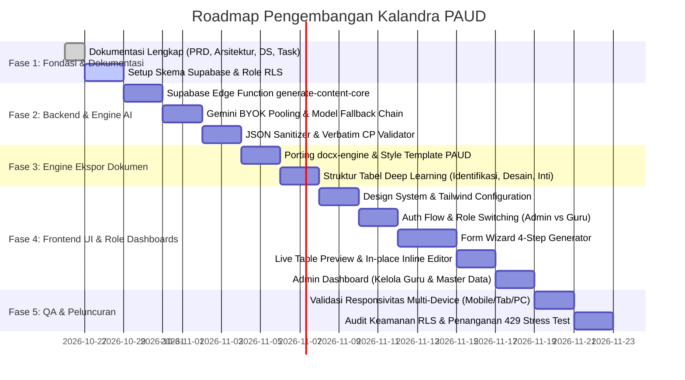

# Rencana Proyek: Generator Perencanaan Pembelajaran Mendalam (RPM) TK / PAUD

> **Status Proyek:** Fase Perencanaan & Spesifikasi Arsitektur  
> **Versi Regulasi:** Permendikdasmen No. 10/2025 (8 DPL), Permendikdasmen No. 12/2025 (Standar Isi), Permendikdasmen No. 1/2026 (Standar Proses Deep Learning), Keputusan BSKAP No. 046/H/KR/2025 (CP PAUD Fase Fondasi)  
> **Arsitektur Utama:** BYOK Multi-Key Gemini Rotation, Model Chain Fallback, Client-side Retry & Validation, Supabase RLS (Admin & Guru), Print-Ready OOXML DOCX Engine  

---

## 1. Ringkasan Eksekutif & Visi Produk

Aplikasi ini adalah **Generator Dokumen Perencanaan Pembelajaran Mendalam (RPM) untuk TK / PAUD Fase Fondasi** (Kelompok A 4-5 tahun dan Kelompok B 5-6 tahun) berbasis Web Responsif multi-perangkat (Mobile, Tablet, Desktop).

Tujuan utama sistem adalah:
1. **Mengeliminasi Beban Administratif Guru TK**: Mengubah penyusunan RPP mingguan (6 Hari / 5 Hari dengan 18 kegiatan bermain mendalam) dari 6-8 jam manual menjadi kurang dari 2 menit dengan bantuan AI terpandu.
2. **Kepatuhan Regulasi 100% Anti-Halusinasi**: Menghilangkan istilah lama (seperti "P5" / "Profil Pelajar Pancasila") dan menggantikannya dengan **8 Dimensi Profil Lulusan (DPL1 - DPL8)**, menyalin Capaian Pembelajaran secara *verbatim* dari database `cp_paud_detail_2025.json`, serta memastikan siklus pembelajaran *Memahami (H1-H2)*, *Mengaplikasi (H3-H4)*, dan *Merefleksi (H5-H6)* berjalan konsisten.
3. **Ketahanan Infrastruktur dengan BYOK Gemini Pooling**: Mengatasi limit kuota gratis Google AI Studio (429 Rate Limit) melalui rotasi dinamis multi-kunci API guru/sekolah dan fallback berjenjang model Gemini (`gemini-3.6-flash` -> `gemini-3.5-flash` / `gemini-3.0-flash` -> `gemini-2.5-flash` -> `gemini-2.5-flash-lite`).
4. **Ekspor Microsoft Word Siap Cetak (Publisher-Grade DOCX)**: Mengompilasi dokumen berstandar administratif resmi (A4/F4, margin 3-2.5-2-2.5 cm, tabel `cantSplit`, `tblHeader` berulang otomatis di tiap halaman, zebra styling, dan penomoran halaman otomatis).
5. **Dukungan Dua Peran (Role-Based Access Control)**:
   - **Admin (Creator / Superadmin Platform)**: Pemilik/kreator aplikasi yang mengelola pengguna (guru), status aktivasi akun, master kurikulum & prompt AI, serta telemetri penggunaan sistem. *(Catatan: Peran Admin Sekolah/Kepala Sekolah disiapkan untuk roadmap ekspansi masa depan)*.
   - **Guru (End User)**: Pendidik yang menyusun RPM mingguan, mengelola kunci API Gemini pribadi (BYOK), mengedit live preview tabel, riwayat dokumen, dan ekspor DOCX siap cetak.

---

## 2. Rekomendasi Nama Produk (Product Naming Options)

Berdasarkan nilai filosofi PAUD Fase Fondasi, regulasi *Deep Learning* 2025/2026, dan kemudahan pengucapan oleh para pendidik, berikut adalah 5 rekomendasi nama produk:

| No | Rekomendasi Nama | Tagline / Makna | Nilai Branding |
|:---|:---|:---|:---|
| **1** | **Kalandra PAUD** *(Rekomendasi Utama)* | *Platform Perencanaan Pembelajaran Mendalam PAUD Berkesadaran, Bermakna, & Menggembirakan* | Diambil dari bahasa Sanskerta: "Kalandra" berarti *menerangi, ceria, dan membawa kegembiraan*. Sangat cocok dengan filosofi PAUD Permendikdasmen 1/2026. Singkat, anggun, dan berkarakter kuat. |
| **2** | **ModulMendalam TK (M3-TK)** | *AI Generator RPP & Modul Ajar Deep Learning Fase Fondasi* | Sangat lugas, formal, dan mudah dikenali dinas pendidikan maupun yayasan sekolah. Menekankan aspek *Pembelajaran Mendalam*. |
| **3** | **PijakanBermain AI** | *Generator Modul Ajar Berbasis Loose Parts & Scaffolding PAUD* | Mengangkat istilah resmi pedagogi PAUD: "Pijakan Lingkungan Main" (*scaffolding*). Menegaskan bahwa pembelajaran PAUD adalah bermain bermakna tanpa dril calistung mekanis. |
| **4** | **CahayaFondasi** | *Menyusun Langkah Emas Pembelajaran Anak Usia Dini* | Menekankan pentingnya Fase Fondasi (usia 4-6 tahun) sebagai fondasi emas tumbuh kembang karakter, nalar kritis, dan budi pekerti anak. |
| **5** | **RencanaCeria PAUD** | *Perencanaan Belajar Cepat, Guru Bahagia, Anak Ceria* | Hangat, bersahabat bagi guru TK, dan menonjolkan prinsip proses pembelajaran yang "menggembirakan". |

> **Catatan:** Dalam dokumentasi ini, produk akan dirujuk sebagai **Kalandra PAUD** (dengan opsi alias konfigurabel pada level tenant admin).

---

## 3. Tahapan Implementasi (Milestone & Timeline)

Implementasi proyek dibagi menjadi 5 fase berurutan:

### Detail Deliverable Tiap Fase:
- **Fase 1 (Fondasi & Desain Teknis)**:
  - Tersedia 7 dokumen acuan (`plan.md`, `prd.md`, `architecture.md`, `wireframes.md`, `design_system.md`, `log.md`, `task.md`).
  - Skema database Supabase PostgreSQL dengan dukungan tabel: `profiles` (role admin/guru), `user_api_keys`, `school_profiles`, `curriculum_elements`, `generated_documents`, dan `audit_logs`.
- **Fase 2 (Backend Edge Functions & Ketahanan AI)**:
  - Endpoint Edge Function Supabase `generate-content-core` dengan BYOK rotation.
  - Multi-key rotation yang mendeteksi HTTP 429 dan langsung melompat ke kunci berikutnya.
  - Model fallback: `gemini-3.6-flash` -> `gemini-3.5-flash` / `gemini-3.0-flash` -> `gemini-2.5-flash` -> `gemini-2.5-flash-lite`.
  - Client helper `invokeWithRetry.ts` dengan validasi struktur JSON skema PAUD.
- **Fase 3 (OOXML Print-Ready DOCX Engine)**:
  - Modul client-side builder yang menyusun file `.docx` identik 100% dengan `Contoh Perencanaan 1 minggu.docx`.
  - Fitur `table.cantSplit`, `tblHeader`, warna header `DOCX_COLORS.tableHeaderBg`, margin resmi, penomoran `Halaman X dari Y`.
- **Fase 4 (Frontend UI/UX Responsif)**:
  - Antarmuka responsif ramah guru TK dengan palet hangat dan ramah anak namun elegan (Slate & Deep Teal / Amber).
  - Wizard formulir 4 langkah: (1) Identitas Modul, (2) DPL Checkbox, (3) CP Selector & Loose Parts Notes, (4) AI Generate & Live Table Edit.
  - BYOK Key Management Modal & Drawer (Bottom Sheet di HP).
  - Portal Admin untuk memantau aktivitas guru dan data kurikulum.
- **Fase 5 (Testing & Finalisasi)**:
  - Pengujian di layar smartphone (360px - 414px), tablet (768px - 1024px), dan desktop (1280px+).
  - Pengujian ketahanan saat akun Gemini mencapai kuota limit.

---

## 4. Analisis Risiko & Mitigasi Teknis

| Risiko Teknis / Bisnis | Dampak | Probabilitas | Rencana Mitigasi |
|:---|:---:|:---:|:---|
| **Limit Kuota Google Gemini API (429 Rate Limit)** | Tinggi | Tinggi | Mekanisme BYOK pooling multi-key; guru dapat memasukkan 2-5 API key gratis dari akun Google berbeda. Sistem otomatis mengalihkan permintaan ke key berikutnya seketika 429 terdeteksi tanpa membatalkan proses. |
| **Model Gemini Mengalami Deprecation / 404** | Tinggi | Sedang | Menggunakan `GEMINI_MODEL_CHAIN` berjenjang; jika model tier experimental/terbaru belum aktif, sistem otomatis turun ke model yang tersedia. |
| **Halusinasi Format PAUD (Masih menyebut P5 atau LKS Calistung)** | Kritis | Sedang | Menanamkan aturan negatif ketat di `systemInstruction` dan skema validasi deterministik client-side sebelum render. |
| **Kutipan Capaian Pembelajaran Berubah / Mengarang** | Tinggi | Sedang | Capaian Pembelajaran dan Subelemen diambil langsung dari `cp_paud_detail_2025.json` dan disuntikkan ke prompt dengan instruksi *verbatim copy*. |
| **Tabel Terpotong Canggung Saat Dicetak di Microsoft Word** | Sedang | Rendah | Mengaktifkan properti OOXML `cantSplit: true` pada seluruh baris tabel dan `tblHeader: true` pada baris kepala tabel. |
| **Tampilan Pecah di HP Guru saat Merancang Modul** | Sedang | Sedang | Mengadopsi arsitektur mobile-first: tabel preview dilengkapi opsi tampilan kartu accordion untuk smartphone, drawer modal bottom-sheet, dan tombol aksi melayang (*floating bottom action bar*). |

---

## 5. Kriteria Keberhasilan (Acceptance Criteria)

1. Guru dapat merampungkan penyusunan RPM 1 minggu (6 hari / 18 aktivitas main) dalam < 2 menit.
2. Tidak ada istilah "P5" atau "Profil Pelajar Pancasila" dalam dokumen yang dihasilkan.
3. Seluruh 8 Dimensi Profil Lulusan (DPL1 - DPL8) terpetakan dengan tepat antara tabel Identifikasi, label kegiatan harian, dan asesmen akhir.
4. File `.docx` yang diunduh langsung dapat dibuka di Microsoft Word / WPS Office tanpa peringatan berkas rusak dan siap cetak dengan margin serta tata letak tabel yang rapi.
5. Guru dapat menyimpan dan mengelola lebih dari 1 API Key Gemini secara mandiri dan aman.
6. Admin sekolah dapat melihat rekapitulasi perencanaan yang dibuat seluruh guru tanpa memiliki akses untuk menyalahgunakan API key pribadi guru.
